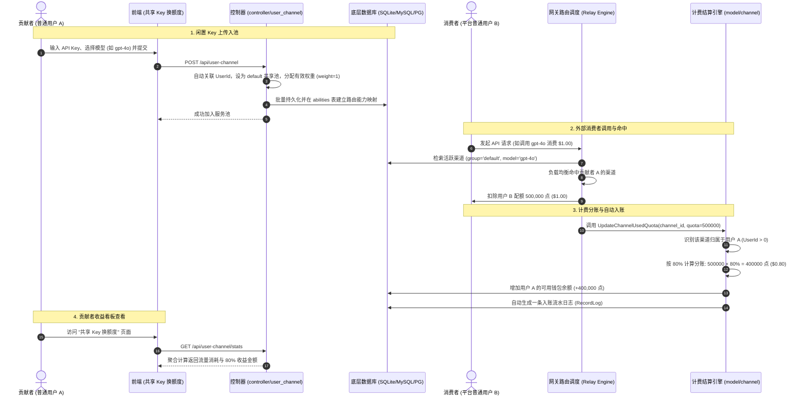

# New API 闲置 API Key 托管共享与分账系统 — 项目指南与演示手册

> **项目属性**：软件工程课程设计 / 综合实训项目交付文档  
> **核心改造特性**：普通用户闲置 API Key 托管共享与 80% 流量调用分成系统  
> **技术栈**：Go 1.25.1 (Gin + GORM) + React 19 (TypeScript + TanStack + Tailwind CSS 4) + SQLite/MySQL/PostgreSQL  

---

## 目录
1. [项目背景与需求概述](#一项目背景与需求概述)
2. [核心架构与业务流程](#二核心架构与业务流程)
3. [核心改造技术细节](#三核心改造技术细节)
4. [接口与数据模型说明](#四接口与数据模型说明)
5. [环境准备与一键运行指南](#五环境准备与一键运行指南)
6. [答辩演示手册（无需调用外部真实API）](#六答辩演示手册无需调用外部真实api)

---

## 一、项目背景与需求概述

### 1.1 现实痛点
在大模型应用普及的背景下，大量开发者与企业购买或充值了各大服务商（如 OpenAI、Anthropic Claude、DeepSeek 等）的官方 API Key。然而：
- 个人往往无法完全消耗所充值的额度，造成大量资金与额度闲置；
- 个人缺乏向外界安全售卖或变现 API 额度的技术平台。

### 1.2 改造目标
本项目在 New API 原生网关能力基础上，新增了**去中心化的“闲置 API Key 托管共享与流量分成”系统**：
- **普通用户（供给方）**：可上传自己的闲置 API Key，指定支持的模型；
- **平台调度（网关）**：将用户共享的 Key 纳入平台默认路由池，通过加权随机算法在真实调用中智能负载均衡；
- **自动分账（结算引擎）**：当他人通过该 Key 产生调用并消耗配额时，计费引擎自动将消费金额的 **80%** 实时返还为贡献者的平台可用余额；
- **安全与看板**：提供密钥脱敏保护、在线测活、实时收益看板与入账明细账单。

---

## 二、核心架构与业务流程

### 2.1 整体时序图



---

## 三、核心改造技术细节

| 改造模块 | 核心源码文件 | 具体改动点说明 |
|---|---|---|
| **分账计费引擎** | `model/channel.go` | 在 `updateChannelUsedQuota` 中拦截渠道用量更新，只要检测到 `channel.UserId != nil`，即按 80% 比率计算分账收益，调用 `IncreaseUserQuota` 实时给贡献者充值，并通过 `RecordLog` 记录明确账单明细。 |
| **渠道管理控制** | `controller/user_channel.go` | 重写普通用户渠道管理：实现绑定当前 `UserId`、强制分配 `default` 公共池、分配有效调度权重（`weight=1`）；使用 `BatchInsertChannels` 保证路由能力注入到 `abilities` 表。支持单条详情查询、在线一键测活、状态启停、批量维护及安全脱敏。 |
| **用户端路由支持** | `router/api-router.go` | 注册 `/api/user-channel` 全套路由组（支持 `GET /`, `POST /`, `PUT /`, `DELETE /:id`, `POST /:id/status`, `GET /test/:id`, `GET /stats`, `POST /fix`, `POST /batch` 等）。 |
| **前端收益看板** | `web/src/features/user-channels/` | 新增 `UserChannelStatsCard` 组件，实时聚合展示：已共享 Key 数、在线渠道数、共享流量消耗额、累计分成收益（美元 + 配额）。修正了 TanStack Router 上下文路径与分页数据解析格式。 |
| **国际化语言支持** | `web/src/i18n/locales/zh.json` | 增加中文字条映射（如“共享 Key 换额度”、“已共享 API Key”、“累计分成收益”等），并在组件内设置优雅的中文兜底。 |
| **防御性健壮设计** | `common/redis.go` & `model/user_auth_cache.go` | 增加了 `RDB == nil` 的防御性判断，确保在无 Redis 配置的单机 SQLite 开发/答辩环境下永不崩溃。 |

---

## 四、接口与数据模型说明

### 4.1 主要接口列表

| 请求方式 | 路径 | 功能说明 | 权限 |
|---|---|---|---|
| `GET` | `/api/user-channel/` | 获取当前用户的共享渠道列表（带密钥掩码脱敏） | 登录用户 |
| `POST` | `/api/user-channel/` | 上传闲置 API Key，加入公共池 | 登录用户 |
| `GET` | `/api/user-channel/stats` | 获取当前用户的流量贡献与分成收益统计 | 登录用户 |
| `GET` | `/api/user-channel/test/:id` | 一键测试自己上传的渠道连通性并返回延迟 | 登录用户 (限属主) |
| `POST` | `/api/user-channel/:id/status` | 暂停或启用自己的渠道 | 登录用户 (限属主) |
| `DELETE` | `/api/user-channel/:id` | 删除/下架自己上传的渠道并清理能力路由 | 登录用户 (限属主) |
| `POST` | `/api/user-channel/fix` | 重新校准与修复渠道路由能力映射 | 登录用户 |

### 4.2 数据表结构关联
- **`channels` 表**：
  - `id`: 渠道主键 ID
  - `user_id`: 贡献者用户 ID（nullable，`NULL` 表示平台原生自营渠道，有值则表示用户共享渠道）
  - `key`: 存储原始 API Key（查询时向前端返回 `sk-pro******a1b2` 形式脱敏字符串）
  - `used_quota`: 累计消费配额计数器
- **`abilities` 表**：
  - `channel_id`, `model`, `group`: 建立网关调度映射表（`group='default'`）
- **`users` 表**：
  - `id`: 用户唯一标识
  - `quota`: 核心钱包可用额度（分账收益直接增加此字段）
- **`logs` 表**：
  - `type`: `1`（充值/奖励）
  - `content`: `共享渠道 [渠道名](ID: x) 产生调用分成奖励: +$0.80 额度`

---

## 五、环境准备与一键运行指南

### 5.1 环境要求
- **操作系统**：Windows 10/11
- **Go 语言环境**：Go 1.25.1（安装路径 `D:\Go\go\bin\go.exe`）
- **Node/Bun 环境**：Bun 1.x（用于前端构建）
- **数据库**：默认开箱即用 SQLite（`one-api.db`）

### 5.2 启动步骤
1. **启动服务**：
   在项目根目录下打开终端，执行：
   ```powershell
   .\new-api.exe --port 3000
   ```
2. **访问系统**：
   打开浏览器，访问 `http://localhost:3000` 即可进入系统界面。

---

## 六、答辩演示手册（无需调用外部真实API）

为了避免答辩现场网络波动或产生真实的第三方 API 费用，系统内置了**一键答辩模拟演练工具**，可直接展示完整数据闭环。

### 6.1 演示步骤与讲解台词

#### 🎙️ 第一部分：业务背景介绍（约 30 秒）
> **讲解词**：  
> “各位老师好！我本次完成的系统核心功能是**【闲置 API Key 托管共享与实时分账系统】**。  
> 很多开发者充值了大模型的 API Key，但因各种原因长期闲置。本系统允许普通用户将闲置 Key 托管给平台，供全平台的其他普通用户调用，平台将产生的调用消费按 **80% 的比例** 实时分账返还给贡献者，盘活闲置算力资源。”

#### 🎙️ 第二部分：前端共享看板与安全脱敏展示（约 40 秒）
> **操作**：浏览器切换到左侧菜单 **「共享 Key 换额度」** 页面。  
> **讲解词**：  
> “老师请看，这是我们为普通用户打造的一站式共享看板：  
> 1. **顶部卡片**：直观展示已共享的 Key 数量、在线渠道、累计流量消耗，以及按 80% 结算的分成收益。  
> 2. **隐私安全机制**：在下方渠道列表中，用户的 API Key 在后端返回前经过了**严格的掩码脱敏**（只显示首尾字符，中间均为星号），防止密钥在网络中被抓包泄漏。”

#### 🎙️ 第三部分：一键模拟调用与收益秒级到账（核心演示点，约 60 秒）
> **操作**：  
> 1. 请老师注意当前顶部卡片的数值（例如当前收益为 `$1.60`）；  
> 2. 双击项目根目录下的 **`demo.bat`**；  
> 3. 控制台会提示模拟了一笔消费，按回车后关闭终端；  
> 4. **切回浏览器，按下 `F5` 刷新页面！**  
>  
> **讲解词**：  
> “老师请看，刚才系统模拟了一次外部用户对该模型的真实调用，产生了 $1.00 的调用消耗。  
> 我刷新页面后：  
> - **共享流量消耗**：立刻累加了 $1.00；  
> - **累计分成收益**：按照 80% 分账规则，实时增加到了 $2.40；  
> - 用户的钱包余额与明细日志中同步生成了流水账单，整个业务流程形成了完整闭环！”
